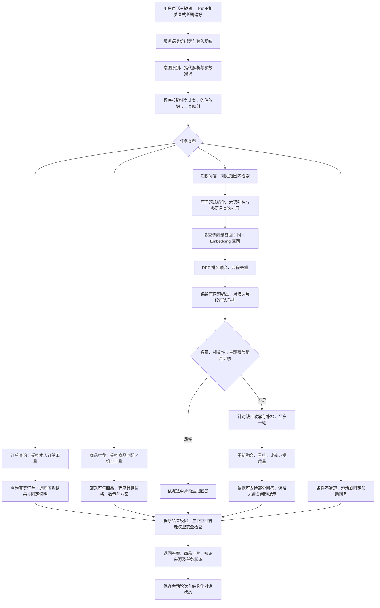
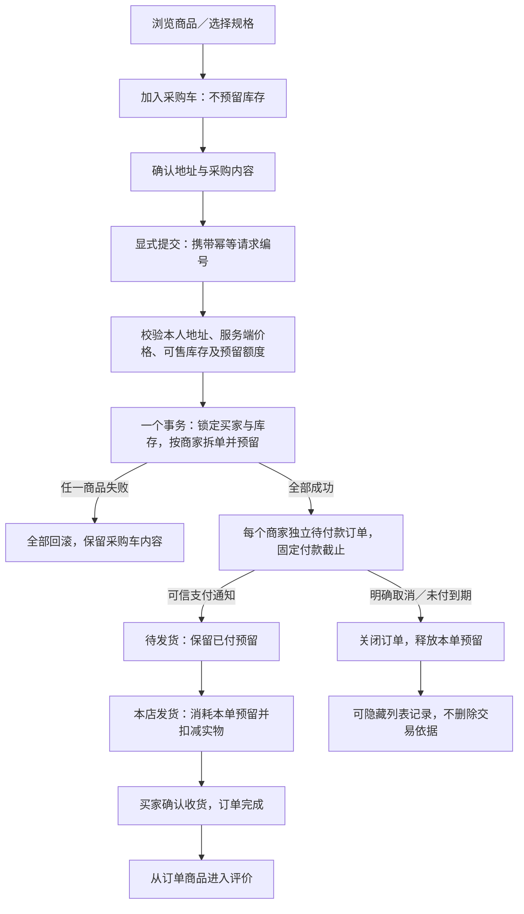
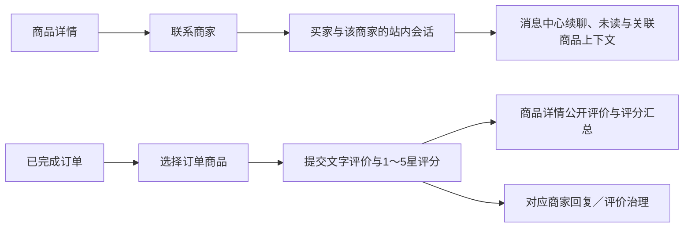

# tea_saas｜多商家茶叶采购与智能客服平台

**个人工程实践项目 · Django / LangGraph / MySQL / Redis / PostgreSQL / pgvector**

tea_saas 围绕茶叶采购场景，将商品发现、多商家交易、库存履约、买卖双方沟通、购买后评价与 AI 选茶咨询组织在同一套系统中。买家完成采购，商家管理本店商品与订单，平台运营维护账号权限、Agent 配置及运行监控。

项目重点是两条相互衔接的流程：**交易流程保证权限、金额、库存与订单状态一致；AI 流程把自然语言转换为受控任务，通过业务工具或知识证据作答。**

本文按当前分支源码描述功能与设计。系统采用 Django 多 App 单体架构，SaaS 是产品定位；当前以账号、角色和商家归属隔离业务数据，未实现企业租户体系、订阅套餐或自动计费。源码开放获取，仅限非商业用途，详见 [LICENSE](LICENSE)。

## 阅读导航

- [业务场景与功能地图](#features)
- [智能客服：从用户表达走到可核验结果](#agent)
- [交易与库存：从采购意向走到履约](#trade)
- [多商家协作：商品、咨询与评价](#collaboration)
- [商家经营与平台运营](#operations)
- [技术结构与数据分工](#architecture)
- [关键设计取舍与验证](#engineering)
- [当前边界与后续方向](#scope)
- [源码与设计文档导航](#documents)

<a id="features"></a>

## 业务场景与功能地图

项目以“买家采购—商家供货—平台管理”为主线，功能按业务职责组织，而非按页面数量堆叠。

| 业务模块 | 用户可以做什么 | 主要设计 | 源码入口 |
| --- | --- | --- | --- |
| 身份与权限 | 统一登录，自动进入对应工作台，维护资料、昵称及地址 | JWT 身份、RBAC 平台权限、本人／本店对象范围 | [users](users/)、[权限分流](users/access.py) |
| 商品发现 | 按茶类、店铺、价格等条件选品，查看规格、图片、评价，收藏及查看足迹 | SPU / SKU 分层、统一可售库存、真实图片优先、查询条件恢复 | [goods](goods/)、[买家页面](client/templates/) |
| 交易与履约 | 管理采购车，按商家下单，付款、取消、发货及确认收货 | 原子预留、幂等、订单归属快照、状态检查、到期释放 | [orders](orders/)、[inventory](inventory/)、[pays](pays/) |
| 买卖双方协作 | 从商品详情联系商家，在订单完成后评价购买的商品 | 私聊与评价分离、消息幂等、购买凭据、商家维度评分汇总 | [engagement](engagement/) |
| 买家 AI 客服 | 问茶知识、推荐商品、组合预算、追问推荐理由、查询本人订单 | 有限意图、受控工具、多轮状态、证据检索与结果校验 | [support_ai](support_ai/)、[ai_storage](ai_storage/) |
| 商家经营 | 管理商品、库存、订单、店铺页面，查看待办与销售洞察 | 本店明细聚合、统一已付口径、真实数据与未知数据区分 | [supplier](supplier/)、[店铺服务](supplier/storefront.py) |
| 平台运营 | 管理业务账号，调整 Agent 模型及检索配置，定位运行问题 | 权限检查、配置快照与修订记录、结构化日志及可选链路追踪 | [admin_panel](admin_panel/)、[运行日志](tea_saas/runtime_logging.py) |

三端使用同一个账号密码登录入口，工作台由服务端根据有效身份和权限决定。前端菜单承担导航职责，接口继续检查身份与对象归属。买家与商家页面提供中文、英文、阿拉伯文及 RTL 支持，具体覆盖范围随页面而异。

<a id="agent"></a>

## 智能客服：从用户表达走到可核验结果

### 1. 核心处理流程

买家可能在同一轮同时提出知识、选品和订单问题。Agent 先识别任务与条件，再由程序选择允许执行的工具；需要商品或订单事实时读取业务数据，需要知识时检索可见文档。



图中按业务阅读顺序归纳流程；具体节点由 [LangGraph 工作流](support_ai/workflow.py) 与 [工具执行器](support_ai/execution.py) 组织。检索支持全文与向量RRF融合、证据不足时一次改写补检；知识回答按结论关联逐字引文并执行独立语义复核。复核仍依赖模型判断，不构成事实正确性的形式证明。

### 2. 语义规划与受控工具

模型负责理解“用户想做什么”，程序负责决定“允许怎样做”。结构化计划包含任务、条件、引用及依赖关系，经过校验后映射到固定工具；不会执行模型生成的 SQL、Python 或任意工具名。

| 用户表达示例 | 处理方式 | 业务事实由谁决定 |
| --- | --- | --- |
| “找两款不超过100元的红茶” | 提取茶类、数量及单价条件，筛选当前可售 SKU | 商品数据库和推荐程序 |
| “总预算200元，搭配几种茶” | 识别总价条件，进入有界组合搜索 | 程序计算每行金额、合计及预算差额 |
| “刚才第二款为什么适合我？” | 绑定原推荐结果的位置，重新读取对应商品事实 | 原结果引用＋当前商品数据 |
| “介绍乌龙茶，再推荐几款” | 生成带依赖的知识介绍与推荐任务 | 知识证据及可售商品集合 |
| “看看我最近待发货的订单” | 校验订单条件，调用本人订单查询工具 | 当前登录身份及订单服务 |

示例用于说明交互与工具分工，不代表任意表达都能一次识别成功。歧义、缺失条件、无匹配及依赖失败通过结构化状态返回，不能包装成成功结果。服务端计划最多5步，执行器限制任务与派发预算；派发预算不等于能够强制中断所有已发出的远程请求。

关键源码：[语义规划](support_ai/semantic_planning.py) · [任务计划](support_ai/planning.py) · [工具服务](support_ai/tool_services.py)

### 3. 商品推荐与预算组合

普通推荐先检查分类、品牌、关键词、价格及排除条件，再读取统一口径的可售库存。硬条件用来过滤，显式偏好只作为允许范围内的软条件；不能为了推荐出结果自行放宽预算或补造风味属性。

总价推荐采用“候选筛选 → 有界枚举 → 确定性排序 → 返回前复核”，而不是让模型生成购物清单后自行计算金额：

1. 在符合条件、数量可购买的 SKU 中按茶类和价格段分桶选取，最多40个候选。
2. 自动组合1～4个不同 SPU，各款件数按预算与可售数量求解，不设每款5件上限；明确支持的相同件数要求经原文依据校验后使用。
3. 使用整数分计算，单款／双款整数解补种与有界beam搜索结合；普通模式优先偏好质量，再比较预算差额，明确接近模式另按接近区间排序。
4. 限制搜索节点与计算时间，最多返回3套方案；截断时标记搜索未完成，不宣称全库最优。
5. 返回前重读价格、库存及分类，发生变化时在同一候选范围重新计算一次。

基础币种为 CNY，USD／AED／SAR／EUR 是统一配置下的参考换算，不是实时汇率或外币支付能力。推荐结果不锁价、不占库存，最终以下单时的服务端校验为准。

关键源码：[商品筛选](support_ai/recommendations.py) · [组合搜索](support_ai/budget_combinations.py) · [组合推荐](support_ai/bundle_recommendations.py) · [金额约定](docs/sdd/architecture/currency.md)

### 4. 知识检索与证据选择

知识文档以“文档 → 片段 → 向量空间”组织。检索先限定已发布、当前用户可见的文档，再在相同模型、版本和维度的 Embedding 空间内比较向量，避免混用不同空间的数据。

- **保留原问题。** 规范化、术语别名和中英文扩展提高召回范围，改写文本只作为检索查询，不成为回答证据。
- **按排名融合。** 多查询结果使用 RRF，随后按片段与正文去重，不直接相加不同来源的分数。
- **重排与上下文预算。** 可选本地 BGE Reranker；结合相关性、文档分布、片段数和字符预算选择正文，并标记截断。
- **覆盖不足时有界补检。** 根据证据数量、重排分数及主题覆盖信号追加一轮查询，比较补检质量；补检失败不能抹掉首轮有效证据。
- **证据不足明确说明。** 检索质量检查属于规则信号，无法保证所有问题都得到完整支持；无直接证据时不能编造知识、政策或市场数据。

关键源码：[检索编排](support_ai/retrieval.py) · [查询扩展与覆盖规则](support_ai/query_rewrite.py) · [权限过滤及向量查询](ai_storage/knowledge.py) · [重排序适配](ai_storage/reranking.py)

### 5. 多轮上下文与本人订单查询

短期上下文保存于 MySQL，默认按最近24小时、最多6轮、6000字符筛选，用于解析“第二款”“预算改成300”等表达。结构化对话状态记录待补条件与结果引用，减少只靠历史助手文字猜测用户意图。

长期偏好保存于 PostgreSQL，由用户显式维护；收藏、浏览足迹、助手生成文字不会自动变成硬性采购条件。恢复历史只展示保存快照，不把历史价格、库存或订单状态当作本轮实时结果。

订单工具在执行时从服务端上下文绑定买家身份，模型不决定查询归属。时间、状态、分页及会话引用经过程序校验，响应提供匿名订单 DTO 与固定说明；订单状态和数量来自本次查询，不由模型重写，也不通过聊天自动执行支付或退款。

关键源码：[短期上下文](support_ai/context.py) · [订单查询工具](support_ai/order_queries.py) · [订单契约](support_ai/order_contracts.py) · [长期偏好](ai_storage/models.py)

<a id="trade"></a>

## 交易与库存：从采购意向走到履约

### 1. 交易主流程



一次采购可以包含多家店铺的商品，采购车是跨店选择容器；结算按商家拆成独立订单。**同一次结算的建单与预留全部成功或全部回滚，后续付款和履约则由各店订单独立推进。**

### 2. 防超卖：统一库存事实与事务边界

存在库存账本时，以启用仓的可用数量作为可售事实；没有账本时才回退旧 SKU 库存，并在首次结算的 SKU 锁内初始化仓库账本。`SKU.stock` 是实物总量投影，不能与账本取最大值来恢复已经被预留的库存。

每仓满足：

```text
实物数量 quantity ≥ 0
0 ≤ 预留数量 reserved_quantity ≤ quantity
可售数量 available_quantity = quantity - reserved_quantity
```

预留记录绑定“订单商品项＋库存账本”，保留 `reserved → paid → consumed` 或 `reserved → released` 的状态。生命周期操作遵循“买家 → 订单 → 升序 SKU → 升序库存账本”的锁顺序，约束同一业务对象的并发状态转换；库存不变量同时落在数据库中。商家手动调库存也不能减到已预留量以下。

以库存100件、两个买家分别采购99件和50件为例：在允许该采购比例的配置下，竞争会在事务内串行校验，不能两笔都成功预留。默认在线采购占比阈值还会提前限制过大的单次占用，超限引导联系商家确认。

关键源码：[订单预留与状态转换](orders/reservations.py) · [库存服务](inventory/services.py) · [可售量读取](inventory/availability.py)

### 3. 防恶意占位：限制占用能力，而不只设置超时

| 控制 | 当前试运行默认与行为 | 目的 |
| --- | --- | --- |
| 固定预留期限 | 10分钟，店铺可配置60～900秒 | 到期释放，刷新或重试不续期 |
| 幂等结算 | 同账号、同请求编号、同意图返回原结果；改意图冲突 | 网络重试不重复建单或延长截止 |
| 同商品与累计额度 | 同买家同 SKU 最多一份待付订单；账号最多3笔待付，并检查累计件数／金额 | 防止拆成多次请求绕过单笔规则 |
| 占用时长预算 | 一小时内累计预算1800秒，生效中计承诺时长，取消／到期计实际时长 | 取消重下不能清空占位历史 |
| 冷却与频控 | 多次取消／超时触发冷却；账号结算频率与来源尝试频率受限 | 抑制反复预留和失败请求滥用 |
| 店铺策略审计 | 记录修改人、前后值、依据及生效时间，只影响新预留 | 阈值可调整且可追查 |

每30秒扫描的到期清理进程负责无人访问时释放，接口中的到期检查作为兜底。限额属于可配置的试运行规则，不等同于能完全阻断多账号攻击，也不把大额采购自动转成已实现的授信或定金流程。

### 4. 支付、履约与历史记录

支付结果由可信异步 POST 通知确认，校验签名、应用、收款方、金额、交易状态及唯一交易流水；浏览器返回页只负责跳转，不直接修改已付款状态。重复通知不重复推进订单；关闭后迟到的真实到账记录为待人工退款异常，不重新抢占库存。

商家只能操作完整归属于本店的订单。历史混合商家订单不能由任一商家整单发货或取消；试单、预售分别读取自己的子状态，预售还需检查定金和尾款。保留这些兼容能力不代表已经开放所有试单／预售新建、支付与退款流程。

取消和隐藏是两种操作：取消改变待付状态并释放预留；隐藏只影响本人列表可见性，保留订单、评价和交易依据。支付配置、真实渠道联调和退款处理仍需独立验收。

设计与证据：[库存预留规格](docs/sdd/modules/trade/stock-reservations.md) · [支付服务](pays/service.py) · [交付验证](docs/sdd/evidence/2026-10-26-stock-reservations/delivery.md)

<a id="collaboration"></a>

## 多商家协作：商品、咨询与评价

### 商品组织与发现

SPU 表达茶品系列，承载商家、品牌及分类；SKU 表达具体包装、规格、价格和库存。首页负责茶类发现和均衡精选，采购页承载完整目录与筛选，详情页承载规格选择、商家联系及评价，避免所有功能挤在首页。

图片由统一选择服务处理：真实商品图片优先，缺图时回退到茶类默认图和通用占位；生成的茶类图片单独存放，不覆盖真实上传字段。收藏与足迹按买家隔离，重复收藏幂等，同商品重访更新最近浏览位置；采购筛选与分页状态可在返回详情后恢复。

### 站内咨询与购买后评价



站内咨询是买家与商家之间的人际会话，和 AI 客服分开。会话按买家与商家唯一关联，消息带请求编号防止重复发送；商品上下文方便双方确认咨询对象。双方分别维护已读位置及隐藏状态，私聊内容默认不进入 AI 上下文。当前使用 HTTP 获取消息，不宣称已实现 WebSocket 推送。

评价从“我的订单”的商品项进入，不另设买家评价导航，也不把评价入口跳转为消息中心。只有本人已完成且购买归属可核验的商品项可以评价，每个订单商品一条主评价；商品详情按“商家＋SPU”汇总评分，可进一步看 SKU，防止不同商家同名商品混算。

订单商品保存购买时商家和商品快照。商品后续转移归属时，不把历史成交和评价转给新商家；历史记录缺少可靠归属时先核验，而不是仅凭当前商品商家猜测。

关键源码：[会话与评价模型](engagement/models.py) · [业务规则](engagement/services.py) · [购买后评价设计](docs/sdd/modules/catalog-content/purchase-reviews.md)

<a id="operations"></a>

## 商家经营与平台运营

### 商家：从交易记录形成经营反馈

工作台连接商品管理、库存、订单、店铺页面与买家咨询。待办和近期动态来自本店真实订单、结算记录、消息及物流记录；销售洞察提供热销商品、成交单价分布、销售额排名和自然月趋势。

经营统计先定义口径，再画图：

- 平台和商家共用已付款订单资格，排除待付、仅定金及不符合状态的记录。
- 商家金额取本店历史成交明细的单价乘件数，不使用混合订单头总额，也不分摊其他店铺收入。
- SPU 汇总多个规格，同名但不同 ID 的商品保持独立；近6个月按上海时区自然月计算。
- 无数据、真实零值和接口失败分别展示；切换账号或迟到请求不能覆盖当前店铺数据。
- 可靠的国家、口感和行业来源尚未接入时显示缺口，不从自由地址、订单哈希或固定百分比生成市场结论。

本店销售洞察与部分旧数据中心推算型指标分开，结算记录展示也不代表真实资金清结算。

关键源码：[统一销售资格](orders/analytics.py) · [商家销售洞察](supplier/insights.py) · [工作台待办](supplier/workbench.py)

### 平台：让 Agent 配置与执行过程可检查

平台运营分别检查有效平台角色及对应权限，可管理业务账号、模型参数、检索与重排序配置。每次请求使用配置快照，配置修订号与代码模块版本分开，便于说明“这次回答使用了哪套参数”。

运行日志采用结构化字段白名单，记录请求编号、路由模板、状态、耗时和安全异常信息，避免把聊天原文、凭据、完整订单号或地址直接写入普通日志。HTTP 请求编号与 Agent 幂等请求编号分开；执行 Agent 时可关联 Trace。

可选 OpenTelemetry 链路包含规划、工具、Embedding、召回、重排及模型调用节点，并接入 Collector / Jaeger / Prometheus。观察节点耗时、错误、Token 和检索命中，用于定位慢在模型、数据库还是检索环节；这不等于已配置生产告警、长期保留或完整审计平台。

关键源码：[Agent 运行模块](support_ai/) · [遥测](support_ai/telemetry.py) · [请求日志](tea_saas/request_logging.py) · [日志设计](docs/sdd/modules/platform/runtime-logging.md)

<a id="architecture"></a>

## 技术结构与数据分工

选择 Django 多 App 单体承载当前业务，将鉴权、业务事务和 Agent 工具放在一个可追踪的进程边界内；通过 App 及服务模块划分职责。前端采用 Django 模板、jQuery 和原生 JavaScript 的多页面形式，没有将现有页面描述为前后端分离 SPA，也没有为了展示技术栈拆成微服务。

| 技术／组件 | 在项目中承担的职责 | 设计原因或约束 |
| --- | --- | --- |
| Django 3.2 / Python 3.9 | 页面、业务 API、认证、ORM 事务及管理命令 | 多 App 模块化；依赖基线见requirements，后续升级需验证兼容性 |
| MySQL / InnoDB | 账号、商品、交易、库存、咨询评价、客服会话及运营配置 | 业务事实源；使用事务、行锁、唯一约束和检查约束 |
| Redis | 采购车与缓存 | 保存采购意向及缓存，不作为库存额度和订单状态的最终事实源 |
| PostgreSQL / pgvector | 显式长期偏好、知识文档、片段及向量空间 | 与交易存储分工；数据路由限定对应 App，跨库不伪造外键事务 |
| LangChain / LangGraph / Pydantic | 模型适配、状态流转、结构化意图与工具结果 | 语言理解与程序执行分工，工具及计划需要校验 |
| Ollama / BGE-M3、BGE Reranker | 本地向量化与可选重排序 | 统一向量空间，控制检索候选、正文与调用预算 |
| OpenAI 兼容模型接口 | 语义规划、需要生成的知识回复和安全检查 | 服务端配置与凭据管理，业务价格和订单状态不靠生成 |
| OpenTelemetry | Agent 关键节点、模型和检索观测 | 与请求日志关联，导出和采集按配置启用 |
| 媒体文件 | 商品真实图片与茶类默认图片 | 数据库保存引用；数据库备份不能替代媒体备份 |

当前登记16个实现模块，逐模块版本及变更以 [versions/modules.json](versions/modules.json) 和 [changelog](versions/changelogs/) 为准，README 不复制一张容易过时的版本表。

<a id="engineering"></a>

## 关键设计取舍与验证

### 可以从代码追问的设计问题

| 问题 | 本项目的处理 | 可继续讨论的取舍 |
| --- | --- | --- |
| 为什么加入采购车不占库存？ | 将采购意向与交易承诺分开，在显式下单事务中预留 | 大额采购需要报价、授信或定金等单独流程 |
| 为什么既有超时，又有时长预算和冷却？ | 超时解决单次占用，累计规则约束取消重下 | 多账号攻击与正常批量采购之间仍需更细风控 |
| 为什么不让模型直接查 SQL？ | 服务端绑定身份、固定工具、参数校验、匿名 DTO | 工具接口维护成本换取明确的数据与动作边界 |
| 为什么推荐后还要重读价格库存？ | 推荐是读快照，下单才形成库存承诺 | 高并发下可用性、锁粒度与交互提示需一起考虑 |
| 为什么保留购买时商家快照？ | 让历史订单、销售和评价归属不随商品转移变化 | 历史缺快照的数据必须有证据才能补齐 |
| 为什么 RAG 补检只做一轮？ | 把检索提升限制在候选、模型次数和时间预算内 | 更高召回率要与延迟、成本和错误扩散权衡 |
| 为什么不把所有指标都画成图？ | 先核验来源和口径，缺失数据保留未知状态 | 真实地区、行业与财务数据需要独立接入 |

### 用什么验证这些设计

验证按问题选择测试层，不以 Python / JavaScript 语法通过替代业务验收：

- **MySQL 并发测试：**使用真实多连接验证99／50竞争库存、付款与取消竞争、重复发货、重复幂等编号，以及同账号跨 SKU 绕过累计额度等场景。
- **规则与接口测试：**覆盖身份／对象范围、混合商家订单、子类型状态、隐藏无库存副作用、商家策略审计及历史归属保护。
- **AI 定向测试与评测：**以工具、意图、上下文、订单查询、组合金额和检索行为分别组织用例；模型替身验证程序规则，真实模型评测另行记录输入范围及结果。
- **前端契约：**检查能力标记、重复点击、身份切换、迟到响应、失败重试及状态刷新；模板渲染和浏览器验证与接口检查分开。
- **交付约束：**实现随模块版本和 changelog 交付，Migration 不改写历史，提交及推送检查完整 Diff、模块归属、编号和语法；SDD 记录业务规则及验证证据。

例如，2026-10-26 库存增量交付记录为 **MySQL 54项通过、SQLite 144项中134通过／10项MySQL专用跳过、前端12项通过**，另有5个模板渲染检查。它们只证明该次提交与定向范围，详见 [交付验证](docs/sdd/evidence/2026-10-26-stock-reservations/delivery.md)，不是全项目覆盖率、真实支付结果或生产性能指标。

<a id="scope"></a>

## 当前边界与后续方向

项目已实现多商家采购主流程、库存预留及防占用规则、站内咨询与购买后评价，以及受控买家 Agent。以下能力继续独立推进，不将页面、模型或入口存在视作完整业务交付：

| 方向 | 当前边界／下一步 |
| --- | --- |
| SaaS 商业化 | 目前为平台账号与商家范围隔离；企业租户、订阅、套餐及自动计费未实现 |
| 支付、退款与财务 | 有可信回调处理；真实商户联调、自动退款、支付账本及资金结算仍需完善，本地配置状态不代表所有环境 |
| 试单、预售及外部履约 | 保留历史状态和发货保护；完整新建／支付／退款生命周期及生产物流、报关集成未完成 |
| 检索与答案质量 | 已接入混合召回、证据核验与缓存；继续扩展独立多语言题集，既有小样本或组件结果不代表任意问答可靠 |
| PDF与商家AI | 平台知识已有PDF/OCR任务、逐页追溯、显式发布及可选PaddleOCR／视觉适配；商家助手仍为入口与状态，商家私有文件、视频及经营工具未形成完整业务链路 |
| 风控与运维 | 验证码／设备及多账号风控、生产容量测试、告警和数据保留策略仍需建设；本地后台进程不等于生产托管 |

<a id="documents"></a>

## 源码与设计文档导航

建议先沿一个业务问题阅读，再按需查看运行配置。完整启动命令和环境变量移至运维／接手文档，避免与功能设计主线混排。

| 想进一步了解 | 阅读入口 |
| --- | --- |
| Agent 如何规划、执行和保存多轮状态 | [语义规划与任务状态](docs/Agent语义规划与任务状态.md)、[当前Agent能力](docs/sdd/modules/ai-support/current-agent.md) |
| 如何补检、融合与选择知识片段 | [查询改写](docs/Agent查询改写.md)、[检索源码](support_ai/retrieval.py) |
| 总预算推荐如何计算而不靠模型凑价 | [组合推荐规格](docs/sdd/modules/ai-support/total-budget-recommendation.md)、[组合算法](support_ai/budget_combinations.py) |
| 如何防超卖与防恶意占库存 | [库存预留规格](docs/sdd/modules/trade/stock-reservations.md)、[库存预留ADR](docs/adr/0004-order-stock-reservations.md) |
| 咨询与评价为什么分开 | [站内咨询](docs/sdd/modules/merchant-operations/buyer-merchant-conversations.md)、[购买后评价](docs/sdd/modules/catalog-content/purchase-reviews.md) |
| 销售看板如何得到真实指标 | [本店销售洞察](docs/sdd/modules/merchant-operations/sales-insights.md)、[统一销售口径](docs/sdd/modules/platform/sales-reconciliation.md) |
| 如何定位请求、模型和检索异常 | [运行日志](docs/运行日志.md)、[Agent监控与模型设置](docs/Agent监控与模型设置.md) |
| 如何理解当前领域与模块 | [领域术语](CONTEXT.md)、[SDD入口](docs/sdd/README.md)、[模块版本](versions/modules.json) |
| 如何运行、接手及准备依赖 | [项目接手指南](docs/项目接手指南.md)、[环境配置](docs/环境配置.md)、[PostgreSQL与pgvector](docs/PostgreSQL与pgvector配置.md) |

## 许可

个人学习与工程实践项目，允许按 [非商业使用许可](LICENSE) 免费获取、阅读、修改和分享有权授权的原创代码与文档。禁止源码销售、付费部署、商业项目交付、商业 SaaS 运营及其他商业用途；衍生版本须保留限制与项目来源。该许可不是 OSI 认可的开源许可，第三方依赖、模型、图片和其他素材遵循各自授权。
