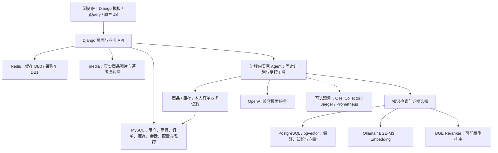

# tea_saas

**个人项目 · 源码开放获取 · 禁止商用**

本项目由个人维护，用于学习、研究与工程实践。允许免费获取、阅读、修改和分享本项目中有权授权的原创代码与文档，仅限非商业用途。禁止出售源码、付费部署、商业项目交付、商业 SaaS 运营、企业商业业务使用及其他直接或间接商业行为；修改或衍生版本同样受此限制。分享时须保留版权、许可及项目来源。完整条款见 [非商业使用许可](LICENSE)，第三方依赖和素材遵循各自授权。

面向跨境茶叶采购与商家经营的 SaaS 平台，面向管理员、商家、买家三类角色提供对应工作台，覆盖平台管理、商品采购、订单协作、库存、经营统计、结算记录展示与买家 AI 客服。

项目采用 **Django 多 App 单体后端 + Django 模板 / jQuery / 原生 JavaScript 多页面前端**。买家 Agent 基于 LangChain / LangGraph，运行在 Django 应用进程内；MySQL、Redis、PostgreSQL / pgvector 及本地推理服务分别承担业务存储、采购车缓存和知识检索职责。

**当前状态：**业务实现、演示数据和待扩展入口并存，尚不能据此认定完整生产交易或商家 AI 能力已交付。SaaS 为平台定位，当前未实现租户级数据隔离、订阅套餐或自动计费。模块版本以 [`versions/modules.json`](versions/modules.json) 为准，业务规格和验证边界见 [`docs/sdd/`](docs/sdd/README.md)。

[项目接手指南](docs/项目接手指南.md) · [环境配置](docs/环境配置.md) · [当前模块版本](versions/README.md) · [SDD 入口](docs/sdd/README.md)

## 目录

- [功能与角色](#capabilities)
- [系统架构](#architecture)
- [工程组成](#repository)
- [当前模块版本](#versions)
- [环境要求](#requirements)
- [本地启动](#quickstart)
- [关键设计](#design)
- [页面与 API 导航](#entrypoints)
- [数据与迁移](#data)
- [验证与调试](#verification)
- [开发与交付](#development)
- [已知问题与文档](#limitations)

<a id="capabilities"></a>
## 功能与角色

系统角色分为 **管理员、商家、买家**，各角色的功能与当前实现边界如下。

| 角色 | 当前提供的能力 | 实现边界 |
| --- | --- | --- |
| 管理员 | 业务用户管理、Agent 模型配置、重排序参数、配置变更记录、监控与链路查看 | 使用业务权限校验；平台管理工作台 |
| 商家 | SPU / SKU 维护、图片上传、上下架、库存、订单协作、经营看板和结算展示；商家智能助手入口及认证后的模块状态 | 部分经营指标为演示推算，结算页面不代表实际资金清结算；`merchant_ai 0.1.0` 仅初始化入口，输入禁用，无聊天 / 上传接口，不调用模型 |
| 买家 | 分类浏览、商品详情与规格、采购车、订单与收货操作、资料和收货地址；商品收藏 / 取消、收藏分页、自动浏览记录、单条删除和清空足迹；AI 多轮知识问答、商品及分类推荐、详情和推荐理由追问、本人订单查询与显式偏好 | 支付可信确认、库存口径和完整履约链路仍有待完善项；收藏与足迹按活跃买家账号隔离，不合并匿名记录，不自动写入 AI 长期偏好；AI 使用受控工具读取业务事实，多轮和检索仍有已记录问题 |

买家和商家导航支持中文、英文、阿拉伯语及 RTL。语言切换覆盖范围取决于具体页面，并非所有业务内容都已完成三语本地化。

<a id="architecture"></a>
## 系统架构



### 存储与服务分工

| 组件 | 保存或处理的内容 | 当前约定 |
| --- | --- | --- |
| MySQL | 用户、RBAC、商品、订单、库存、收藏足迹；客服会话、短期上下文、Agent 配置和监控投影 | 连接来自 `.env` 的 `DB_*` |
| PostgreSQL | 长期偏好、知识文档、知识片段及向量空间 | 由 `AiStorageRouter` 限定 App 读写与迁移 |
| Redis | 默认缓存、采购车 Hash | `REDIS_CACHE_URL`／`REDIS_CARTS_URL` 配置地址，`REDIS_PASSWORD` 配置认证 |
| `media/` | 上传图片和已生成的茶类默认图 | 数据库保存文件路径；备份数据库不能代替备份媒体文件 |
| Ollama / BGE-M3 | 本地知识入库与查询向量化 | 与知识向量空间的模型、版本、维度保持匹配 |
| 本地重排序服务 | 对召回候选重新评分和选证据 | 可启停；超时和异常按运营配置降级 |
| 模型服务 | 意图 / 条件抽取及需要生成的回复 | 服务凭据在后端；不直接暴露给浏览器 |

<a id="repository"></a>

## 工程组成

```text
tea_saas/
├── manage.py                    Django 命令入口
├── tea_saas/                    settings、根路由、认证共享工具
├── client/
│   ├── templates/               管理员、商家、买家页面及演示页面
│   └── static/                  CSS、JavaScript 和静态素材
├── templates/                   邮件等模板
├── users/                       业务用户、角色权限、资料地址
├── goods/                       商品、图片、收藏足迹和数据管理命令
├── carts/                       Redis 采购车
├── orders/                      订单与预结算
├── pays/                        支付集成
├── inventory/                   仓库、库存和流水
├── logistics/                   物流与轨迹
├── supplier/                    商家经营、结算和分析
├── news/                        资讯
├── admin_panel/                 运营管理和 Agent 配置 / 监控 API
├── support_ai/                  买家 Agent、工具、上下文和评测
├── merchant_ai/                 商家助手独立入口模块
├── ai_storage/                  长期偏好、知识、Embedding 和重排序
├── media/                       运行所需的商品及茶类图片
├── deploy/                      PostgreSQL、重排序和监控部署配置
├── docs/                        环境、接手指南、专题设计和 SDD
├── reports/                     数据批次、定向评测和验证材料
├── tools/                       模块版本及诊断工具
└── versions/                    模块清单和各模块 changelog
```

前端与买家 Agent 源码随 Django 项目一起部署，页面由后端渲染，常规运行无需前端构建。MySQL 和 Redis 需要自行准备，现有 Compose 覆盖对应 AI 存储、本地推理与监控服务。

<a id="versions"></a>
## 当前模块版本

当前登记 15 个实现模块，版本独立管理。下表于 2026-10-18 按当前工作区清单核对；后续以机器可读清单和对应 changelog 为准。

| 模块 | 版本 | 主要职责 |
| --- | --- | --- |
| `core` | 0.4.3 | 项目配置、路由、共享工具与交付支撑 |
| `users` | 0.2.5 | 业务身份、RBAC、资料与地址 |
| `goods` | 0.5.1 | 商品、媒体、收藏足迹、茶类默认图、公开店铺摘要与SKU库存 |
| `carts` | 0.1.2 | 采购车与统一图片回退 |
| `orders` | 0.1.6 | 订单、预结算与统一图片选择 |
| `pays` | 0.1.0 | 支付接口 |
| `news` | 0.1.1 | 资讯 |
| `inventory` | 0.1.0 | 仓库、库存和流水 |
| `logistics` | 0.1.0 | 物流和轨迹 |
| `supplier` | 0.2.1 | 商家经营与结算展示 |
| `admin_panel` | 0.4.2 | 运营管理、模型设置与监控 |
| `support_ai` | 0.12.2 | 买家客服与推荐追问 |
| `merchant_ai` | 0.1.0 | 商家助手入口和状态 |
| `ai_storage` | 0.3.3 | 长期偏好、知识和向量检索 |
| `web` | 0.24.0 | 多角色页面、主题、语言、首页发现与10件精选、采购组合筛选与状态恢复、卡片收藏、商家订单分类与数据中心异步展示 |

模块版本、Git 标签、数据库 Migration、Agent 配置 `revision` 和 SDD `specVersion` 表达不同含义；清单中的版本不自动代表已创建标签、已部署或已通过生产验收。

<a id="requirements"></a>
## 环境要求

依赖版本以 [`requirements.txt`](requirements.txt)、Compose 和服务配置为准。

| 工作范围 | 所需环境 | 默认本地地址 |
| --- | --- | --- |
| Web 与业务 API | 项目约定 Python 3.9、Django 3.2.12、MySQL、Redis | Django `127.0.0.1:8000`；Redis `6379` |
| AI 偏好 / 知识 | PostgreSQL 16 + pgvector、Ollama / BGE-M3、可用模型服务 | PostgreSQL `5433`；Ollama `11434` |
| 知识重排序 | Docker Compose 及本地 BGE Reranker 服务 | `127.0.0.1:18081` |
| 可选观测 | OTel Collector、Jaeger、Prometheus | OTLP HTTP `4318`；Jaeger `16686`；Prometheus `9091` |
| 前端脚本语法检查 | 本机 Node.js | 仅用于 `node --check` 等开发检查 |

<a id="quickstart"></a>

## 本地启动

以下使用 PowerShell，均在项目根目录执行。其他系统按实际环境替换激活和复制命令。

### 1. 获取代码与安装依赖

```powershell
git clone https://github.com/dengbofu-git/shop.git tea_saas
cd tea_saas
conda create -n tea_saas python=3.9 -y
conda activate tea_saas
python -m pip install -r requirements.txt
```

已有环境可直接激活后安装依赖；不要重复创建环境覆盖现有工作。

### 2. 准备配置与基础服务

```powershell
if (-not (Test-Path -LiteralPath .env)) { Copy-Item -LiteralPath .env.example -Destination .env }
if (-not (Test-Path -LiteralPath .env.postgres)) { Copy-Item -LiteralPath .env.postgres.example -Destination .env.postgres }
```

创建 MySQL 业务数据库，启动 Redis，并填写配置：

- `DJANGO_SECRET_KEY`、`JWT_SECRET_KEY`、`DB_*`、允许访问的主机和管理账号初始密码。
- 注册与登录使用账号密码；旧短信验证码、邮箱激活／找回密码、微博认证接口已移除，无需配置对应服务。邮箱和手机号仍作为账号资料保留。
- AI 使用 `SUPPORT_API_KEY`、`SUPPORT_BASE_URL`、`SUPPORT_MODEL`；仅浏览商城时可以暂不联调模型，但配置文件仍需保留导入时要求的变量键。
- 使用长期偏好和知识问答时，填写 `.env.postgres` 的 PostgreSQL、Ollama 和向量空间参数。

配置加载顺序是进程环境优先，随后读取 `.env`、`.env.postgres`，文件中的值不覆盖已经存在的值。示例空值不代表对应服务已可用，SMTP、支付等能力需各自完成真实配置。完整说明见 [环境配置](docs/环境配置.md)。

### 3. 迁移业务库与启动 Django

```powershell
python manage.py check
python manage.py migrate --plan --database default
python manage.py migrate --database default
```

新环境需要初始化角色和业务管理员账号时，再执行：

```powershell
python manage.py seed_rbac
python manage.py create_super_admin
```

`create_super_admin` 会重置已有业务 `admin` 的密码并激活账号，不能作为日常启动步骤。业务账号与 `/admin/` 的 Django 认证账号是两套体系，后者使用 `python manage.py createsuperuser` 管理。

```powershell
python manage.py runserver 127.0.0.1:8000
```

通过 [登录页](http://127.0.0.1:8000/login.html) 访问应用，不直接从磁盘打开模板。`runserver` 用于本地开发；本仓库的 Compose 不是完整生产部署方案。

当前前端 `init.js` 的 API / 媒体地址和后端 `TEA_SAAS_MEDIA` 使用 `127.0.0.1:8000`。换域名或端口时，还需一起检查这些地址、CORS、`ALLOWED_HOSTS` 及支付 / OAuth 回调，不能只修改 runserver 参数。

### 4. 按需启用 AI 知识服务

```powershell
docker compose --env-file .env.postgres -f compose.ai-storage.yml up -d --wait
docker compose --env-file .env.postgres -f compose.ai-storage.yml exec ollama ollama pull bge-m3
python manage.py migrate ai_storage --database ai_storage
```

MySQL 的迁移命令不会替代 PostgreSQL 迁移。准备好本地 Embedding 后，需要示例知识语料时再运行：

```powershell
python manage.py import_middle_east_tea_knowledge
```

该命令更新来源文档并重建其知识片段，是写入操作。需要保留现有知识版本时，先核对数据和向量空间，详见 [PostgreSQL 与 pgvector](docs/PostgreSQL与pgvector配置.md)。

### 5. 按需启用重排序与监控

```powershell
docker compose --env-file deploy/reranker/compose.env.example -f compose.reranker.yml up -d --build
docker compose -f compose.agent-observability.yml up -d
```

重排序服务完成模型加载后，在 `admin_agents.html` 中启用相应配置；链路导出也需要运营配置开启。仅启动容器不表示检索质量已验证或已有链路数据。日常停机使用 `stop` 保留数据卷，详细配置见 [本地重排序](docs/本地重排序.md) 和 [Agent 监控](docs/Agent监控与模型设置.md)。

<a id="design"></a>
## 关键设计

### 业务身份与访问边界

业务身份来自 `users.UserProfile` 和 JWT，`user_type` 与 RBAC 角色并存。浏览器使用 `AuthStorage` 管理登录状态，但最终权限和对象归属由服务端处理。私有收藏、足迹、偏好、会话和订单读取不能由客户端自报用户名决定归属；既有业务中仍需继续核查的权限差异见后文。

登录页只有一个账号密码入口，服务端按有效角色及权限返回工作台地址，管理员、商家和买家分别进入对应工作台；旧终端登录地址重定向统一入口。管理员的账号管理功能同时要求有效平台角色及 `user_manage`，Agent 管理要求平台角色及 `system_config`，不再使用商家共有的商品权限代替账号管理权限。完整规则与验证见[统一登录设计](docs/sdd/modules/identity/unified-login.md)。

### 商品、收藏与图片

- SPU 表达商品系列，SKU 表达可定价、可库存管理的具体规格。
- 收藏使用显式 GET / PUT / DELETE，数据库以 `(user, sku)` 唯一，重复收藏不重复插入；取消操作幂等。
- 足迹在成功查看有效商品详情后记录，同 SKU 重访置顶，最多保留最近 100 件，每页 12 件；清空足迹不删除收藏。
- 图片统一由 `goods/images.py` 选择：SKU 真实默认图 → 有效图库图 → 旧媒体文件 → 同 SPU 真实图 → 茶类虚拟图 → 通用占位。
- 虚拟图保存在 `Catalog.fallback_image` 和独立媒体目录，不覆盖 SKU 上传字段；后续上传真实图片会自动优先显示。

收藏页和最近浏览页共用页面模板，通过顶部独立入口访问；页面内部不再重复放置切换栏。采购、精选和推荐卡片支持直接收藏，详情和足迹页也保留收藏操作。

买家首页用于发现茶品：保留沉浸式轮播，茶类图片链接直达对应采购分类，固定最多10件均衡精选，桌面两行五列，不再提供全量计数或分页。商品采购承载全部目录，支持关键词、展示币种价格范围、最低库存、店铺组合筛选和价格排序，每页10件；URL保留条件与页码，详情返回后恢复浏览位置。采购页不展示固定阶梯优惠或重复推荐区。价格为参考换算，库存沿用SKU.stock目录口径，详见[当前规格](docs/sdd/modules/catalog-content/catalog-preview.md)。

### 买家 Agent 与受控执行

主要执行链路是：身份与输入处理 → 有限意图及任务计划 → 校验后的固定工具 → 业务事实 / 知识证据 → 组合回复与安全检查 → 会话记录。

`planning.py` 定义任务计划，`execution.py` 按依赖和预算执行服务端注册的工具。工具结果只返回结构化数据，不决定任意下一步或执行模型生成的代码；商品、价格、库存和订单事实来自业务服务。

推荐支持茶类、品牌、关键词、预算、偏好与排除条件的受控表达，条件需要原话证据；分类推荐和总数量受契约约束。0.10.0 增加最近用户茶类主题继承与独立的推荐理由解释，理由解释重新读取绑定 SKU 的当前事实，不等同于再筛一份新商品。

短期多轮上下文与长期偏好分开：前者来自 MySQL 客服会话，按时间、轮数和字符预算筛选；后者保存在 PostgreSQL。商品收藏、足迹、助手生成文字不会自动变成用户明确的长期购买条件。

### 知识检索与运行配置

知识问答使用已发布、当前用户可见的知识文档；查询向量与入库向量属于同一模型空间。当前链路包括查询翻译 / 扩展、多查询融合、去重、可选重排序、来源与正文预算，以及有界的一次补检。

模型、思考模式、重排序和导出开关还受 MySQL `AgentConfiguration` 影响，每次请求使用配置快照。因此 `.env` 中的模型默认值不一定等于当前实际模型，运营 `revision` 也不是代码模块版本。

### 商家助手的独立边界

`merchant_ai` 目前只返回入口状态，`chat_enabled=false`、`model_connected=false`、`capabilities=[]`。它没有会话表、聊天接口或真实业务工具；后续商家能力需要单独定义身份、工具、数据与验收，不直接将买家聊天接口接给商家页面。

<a id="entrypoints"></a>
## 页面与 API 导航

下列为主要入口，完整定义以 [`tea_saas/urls.py`](tea_saas/urls.py) 和各 App 的 `urls.py` 为准。业务 API 的末尾斜线约定并不统一，请使用源码中的准确路径。

| 场景 | 页面 | 主要 API 命名空间或路径 |
| --- | --- | --- |
| 注册 / 登录 / 资料 | `login.html`、`register_sms.html`、`buyer_profile.html` | `/v1/users/` |
| 买家工作台 / 商品 | `buyer_dashboard.html`、`buyer_products.html`、`product_details.html` | `/v1/goods/index`、`catalogs/<id>`、`detail/<id>`、`sku/<id>/image` |
| 收藏 / 足迹 | `myCollect.html`、`recent.html` | `/v1/goods/favorites`、`favorites/<sku_id>`、`recent`、`recent/<sku_id>` |
| 采购车 / 订单 / 支付 | `cart.html`、`orderConfirm.html`、`buyer_orders.html`、`payment.html` | `/v1/carts/`、`/v1/orders/`、`/v1/pays/` |
| 买家客服 | `buyer_support.html` | `/v1/support/chat/`、`preferences/`、`conversations/<uuid>/` |
| 商家经营 | `merchant_dashboard.html`、商品 / 订单 / 库存 / 结算面板 | `/v1/goods/merchant/`、`/v1/supplier/`、`/v1/inventory/` |
| 商家助手 | `merchant_assistant.html` | `GET /v1/merchant-ai/status/` |
| 管理员工作台 | 统一 `login.html` 自动分流；`admin_panel.html`、`admin_agents.html` | `/v1/admin-panel/users`、`/v1/admin-panel/agent/` 下的配置和监控接口 |
| 物流 / 资讯 | `logistics_track.html`及资讯入口 | `/v1/logistics/`、`/v1/news/` |
| Django Admin | `/admin/` | Django 自带管理站点 |

`index.html` 等旧地址存在兼容重定向。部分页面是展示外壳，页面可以打开并不证明其所有业务 API 或外部集成都已实现。

<a id="data"></a>
## 数据与迁移

### 当前迁移检查点

| 数据库 / 模块 | 关键迁移 | 内容 |
| --- | --- | --- |
| MySQL / goods | `0009_browsinghistory_favorite` | 收藏与浏览足迹 |
| MySQL / goods | `0010_catalog_fallback_image` | 茶类虚拟默认图片 |
| MySQL / support_ai | `0002_agent_observability`、`0003_agent_reranking`、`0004_conversation_order_context` | 配置监控、重排序及订单上下文 |
| PostgreSQL / ai_storage | `0001_initial`、`0002_embedding_validation` | 长期偏好、知识向量及向量校验 |
| merchant_ai | 无业务表迁移 | 入口初始化不创建聊天持久化 |

使用当前代码时按数据库执行完整迁移；不要为启用某一功能将已有数据库指定迁移到更旧编号。恢复或回退前同时考虑业务数据、媒体文件、两库身份对应和版本兼容。

### 虚拟商品与茶类图片

仓库包含可追溯的虚拟商品批次和六类茶默认图。2026-10-16 本地核对为 104 个 SKU，其中 102 个通过茶类默认图展示、2 个使用真实图片；这是本地数据快照，不是新安装后的固定商品数量。

```powershell
# 先复制媒体文件并准备匹配茶类；默认只预览和校验
python manage.py register_tea_images --manifest reports/tea-images/2026-10-16/plan.json
# 确认后才写入 Catalog 的默认图片路径
python manage.py register_tea_images --manifest reports/tea-images/2026-10-16/plan.json --apply
```

虚拟图片表示茶类，不是具体商品的实拍、包装或资质证明。图片来源、提示词和哈希见 [图片清单](reports/tea-images/2026-10-16/plan.json)，规则见 [图片设计](docs/sdd/modules/catalog-content/image-fallback.md)。

`seed_virtual_tea_products` 会创建商品和库存，要求明确商家 ID 和数据库服务器 UUID；`seed_demo_orders` 会创建模拟订单。它们都不是首次启动必跑命令。操作前阅读 [虚拟商品数据](docs/虚拟商品数据.md) 和对应 `--help`，不要把示例数据导入已有业务库当作环境检查。

<a id="verification"></a>
## 验证与调试

在项目根目录、配置键已经准备好的情况下执行；按本次实际改动选择范围。

### 静态与隔离检查

```powershell
python manage.py check --settings=support_ai.test_settings
python manage.py makemigrations --check --dry-run --settings=support_ai.test_settings
python tools/module_versions.py check
python manage.py test goods.test_activity goods.test_images merchant_ai --settings=support_ai.test_settings --noinput
python manage.py test support_ai.tests support_ai.test_planning support_ai.test_task_tools support_ai.test_telemetry support_ai.test_grouped_recommendations support_ai.test_mixed_tea ai_storage.tests --settings=support_ai.test_settings --noinput
```

隔离设置使用 SQLite / LocMem，相关模型调用由测试替身提供。真实向量 SQL 和 MySQL 行锁测试可能被明确跳过，跳过不等于通过。使用上面的明确测试标签；`goods/test_mysql_settings.py` 是测试配置模块，不是普通业务用例。

### 真实数据库定向检查

```powershell
# 唯一命名的临时 MySQL 测试库，结束后删除；需建 / 删测试库权限
python manage.py test goods.test_activity goods.test_images --settings=goods.test_mysql_settings --noinput
# 业务使用 SQLite，AI 存储使用独立 test_tea_saas_ai 测试库
python manage.py test ai_storage.tests --settings=support_ai.pg_test_settings --noinput
```

执行前确认测试数据库配置，`--noinput` 不代表只读。浏览器验收、真实模型调用、数据库迁移、部署和发布需要分别记录，不能由上述检查结果替代。

### Agent 终端预览

```powershell
python -X utf8 -u manage.py agent_preview
```

支持 `/config`、`/plan`、`/rag`、`/history`、`/new` 和 `/exit`。明确需要测试买家私有数据时，可使用开发环境的 `--user-id <买家ID>`。

终端预览直接调用真实 Agent，不经过网页 HTTP 鉴权和限流；默认使用独立临时会话，日志进入 `reports/agent-preview/`，不写入客户会话或偏好。它无需网页或 Redis，但仍依赖所选工具需要的 MySQL、知识库和模型服务。详情见 [终端预览](docs/Agent终端预览.md)。

<a id="development"></a>
## 开发与交付

资源清理与评测材料入口见 [报告索引](reports/README.md)。2026-10-16 的 Agent 历史资料已原字节归档，当前输出目录与在途测试继续独立维护。

Git 分支、中文提交、PR 和交付检查统一遵循 [Git 协作规范](docs/Git协作规范.md) 与 [AGENTS.md](AGENTS.md)。每个克隆先运行 `python tools/git_policy.py install` 启用本地 Hook 和提交模板；开发使用 `codex/<模块>-<任务>`，通过 PR 合入 `main`。GitHub Actions 及服务端保护的生效边界见规范。

1. 从当前页面 / 功能找到代码 App、实现模块和对应 SDD 能力，确认已知问题、规则归属及这次变更范围。
2. 新增或改变规则、权限、状态与 API 时，同步更新相应 REQ / RULE / AC、契约和实现差异；已有实现与目标规格有差异时明确登记。
3. 修改共享代码时检查真实消费者；变更商品图片需要联动商品、采购车和订单，变更公共导航需检查买家或商家各页面。
4. 按模块更新代码、`versions/modules.json` 和 changelog；前后端分别评估，纯文档维护不自动抬升业务版本。
5. 对最终改动执行充分的定向检查；有数据库 Migration 时，说明目标数据库、数据兼容和回退方式。
6. 分别记录验证、部署和发布；共享工作区中保留他人改动，提交时只选择明确属于当前交付范围的文件。

版本工具：

```powershell
python tools/module_versions.py list
python tools/module_versions.py changed
python tools/module_versions.py check
# 示例：实际需要升版时再执行
python tools/module_versions.py bump goods patch --note "说明本次修复"
```

标签约定为 `<模块>/v<版本>`，例如 `goods/v0.4.0`；工具不会自动提交或推送。流程见 [模块版本管理](docs/模块版本管理.md)。

tea_saas采用渐进式 SDD，当前仍有候选能力和人工评审阶段，尚未接入自动阶段检查器。日常验证使用本节实际提供的命令；业务能力阶段以本仓库 `docs/sdd/catalog.yaml` 及活动能力 manifest 为准。

<a id="limitations"></a>

### 文档导航

| 文档 | 内容 |
| --- | --- |
| [项目接手指南](docs/项目接手指南.md) | 当前版本、运行边界、账号初始化、命令和交接顺序 |
| [环境配置](docs/环境配置.md) | Python / Conda、MySQL、Redis 和基础环境变量 |
| [当前版本](versions/README.md) / [模块版本管理](docs/模块版本管理.md) | 实现模块、版本与 changelog 约定 |
| [SDD 入口](docs/sdd/README.md) / [功能清单](docs/sdd/product/feature-inventory.yaml) | 业务能力、规格、阶段与证据定位 |
| [收藏足迹规格](docs/sdd/modules/catalog-content/capabilities/CAP-CAT-004/requirements.md) | 收藏、足迹、账号边界与卡片操作 |
| [图片设计](docs/sdd/modules/catalog-content/image-fallback.md) / [虚拟商品数据](docs/虚拟商品数据.md) | 茶类图片、生成记录、种子数据与回退 |
| [PostgreSQL 与 pgvector](docs/PostgreSQL与pgvector配置.md) / [本地重排序](docs/本地重排序.md) | 双库、长期偏好、知识和本地推理服务 |
| [多轮对话](docs/Agent多轮对话.md) / [任务模板](docs/Agent任务模板与对照评测.md) | 上下文、固定任务与受控执行 |
| [分类推荐](docs/Agent分类推荐.md) / [推荐追问修复](docs/Agent推荐追问修复.md) | 分组、主题继承和理由解释 |
| [查询改写](docs/Agent查询改写.md) | 多语言查询、融合和一次补检 |
| [Agent 监控与模型设置](docs/Agent监控与模型设置.md) / [终端预览](docs/Agent终端预览.md) | 运行配置、链路与调试 |
| [商家智能助手](docs/商家智能助手.md) / [全站主题](docs/全站主题规范.md) | 商家入口完成范围与 UI 基线 |
