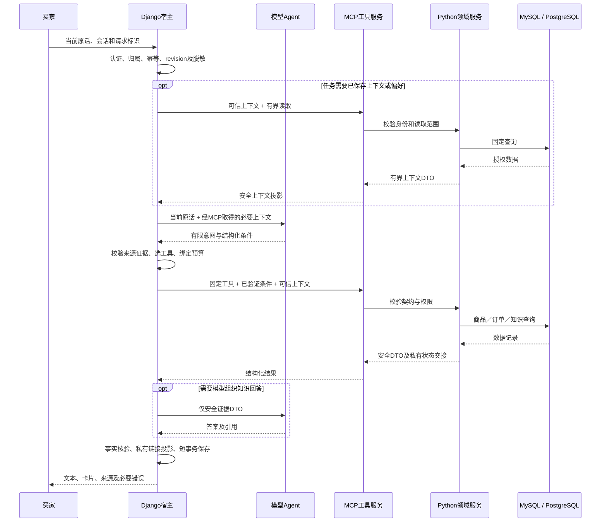

# 模型 Agent 数据访问统一经 MCP

规格0.2.0，2026-10-28。状态：用户已确认的目标架构，应用调用入口已完成源码迁移及隔离验证，业务启用／部署未执行。确认依据为本轮指令“模型 Agent 的数据访问入口统一使用 MCP”及随后“运行”。决定及取舍见[ADR 0009](../../adr/0009-agent-data-access-via-mcp.md)，实施前盘点见[改造清单](../modules/ai-support/mcp-migration.md)，当前实现及边界见[运行设计](../modules/ai-support/mcp-runtime.md)。本规格不自动提升既有 CAP 的验收或部署状态。

## 适用范围

“模型 Agent”包括买家客服的规划、语义提取、问答和工具编排，以及未来开放的商家模型助手。“数据访问”包括读取数据库、业务接口或持久缓存中的业务事实，以及宿主预先读取并注入模型的持久化数据。不能通过把查询移到模型调用前绕过本规则。

本轮统一的是模型 Agent 的数据入口，不是把整个 Django 项目改成 MCP 应用。MCP Server 后端仍须保留可信 Python 业务服务；普通页面接口、管理员操作、数据导入、PDF/OCR Worker 和数据库维护按各自权限运行。

## 访问边界

### RULE-AI-MCP-001 唯一入口

模型 Agent 消费的商品、价格、库存、属性、订单、知识证据、长期偏好及持久化历史上下文，统一通过宿主控制的 MCP Client 调用允许的 MCP 工具取得。模型负责有限语义与结构化条件，宿主验证并选择工具；不要求模型自行生成工具名或直接执行每次调用。

正式切换后移除 Agent 侧 LocalInvoker、直接 ORM/SQL、直接调用数据服务和业务数据接口的旁路；MCP 超时、权限失败或不可用时不得回退本地查询。MCP 后端业务服务中的 ORM、固定 SQL、库存计算和检索算法继续保留。

### RULE-AI-MCP-002 宿主控制与业务数据分开

| 位置／行为 | 访问方式与约束 |
| --- | --- |
| 商品候选、组合推荐、详情、推荐解释中的实时事实 | MCP；公开范围、人民币金额、库存和硬条件仍由后端程序判断 |
| 本人订单、查询分页及私有指代的业务读取 | MCP；后端重验本人范围、会话及有效绑定 |
| RAG 检索及模型使用的知识片段／引用 | MCP；后端执行发布状态、ACL、向量空间和检索预算约束 |
| 模型输入中的长期偏好、已保存历史及商品／方案引用 | MCP；宿主可按需主动取上下文；不能提前 ORM 读取正文再注入 |
| 当前轮用户原话、纯类型／证据校验、固定欢迎语、金额纯计算 | 本地纯函数；不因采用 MCP 而增加模型或数据库依赖 |
| HTTP 认证、RBAC、账号状态、会话归属／revision、幂等重放、配置快照及密钥装配 | 宿主控制职责，可使用原有后端方法；不能借此向模型附带业务事实 |
| 会话保存、遥测、用户显式偏好编辑、历史列表／恢复页面 | 普通应用服务；不赋予模型任意写入权限。历史响应用于模型续聊时另经 MCP 上下文投影 |
| 商品管理、订单交易、采购车、支付、库存、人工咨询、PDF 导入／审核／发布 | 保持原业务入口与权限；不是本次统一入口的迁移对象 |

同一函数兼具两类职责时必须拆分。示例：宿主直接校验会话属于本人是控制操作；读取该会话问答及推荐结果给模型则是 MCP 数据操作。普通 API 编辑偏好可以保留 ORM，客服使用该偏好时仍走 MCP。

### RULE-AI-MCP-003 工具及身份授权

仅注册有明确用途、严格输入／输出结构和公开字段白名单的领域工具。禁止任意 SQL、ORM 字段／表达式、任意 HTTP 地址、文件路径、Shell 或动态 Python 执行工具。工具注解中的 readOnlyHint 不是权限校验。

本次迁移以只读数据工具为限；交易写入、自动维护偏好、知识发布和商家经营写入不在授权范围，后续如需开放必须另定业务规格与验收。

owner、角色、有效权限、conversation、request 及当前轮引用映射由已认证宿主建立可信上下文，不接受模型自报身份。私有工具必须在服务端验证上下文有效期、用途／受众、允许工具和对象归属；MCP 会话 ID、前端参数、模型 evidence 或知道订单号均不能构成授权。公开商品工具不能成为私有工具的匿名降级路径。

可信上下文与模型参数分离，不进入模型提示词、模型可见工具结果或普通日志。stdio 的受控进程配置与远程 HTTP 的认证机制分别设计；当前开发者 stdio 接入没有买家授权能力，不能直接复用为订单入口或暴露公网。具体传输和凭据方案在实施时验证，本规格不宣称已实现认证协议。

### RULE-AI-MCP-004 输出与私有状态

后端仅返回领域 DTO，宿主再次校验结构后映射现有 ToolResult；不传 Django Model、QuerySet、SQL、连接配置、完整订单或未经投影的数据库记录。公开结果保留 schema_version、业务状态、读取时间、来源及必要限制；技术错误保留安全错误码和可重试含义。

真实订单号、当前选择、导航令牌和结果位置映射只在应用私有范围流转。拆分现有 OrderQueryContext 的公开查询结果与私有状态效果：私有效果通过绑定本轮的服务端句柄或可信宿主通道交接，再由宿主短事务复验 revision 并保存。不能把私有字段放入模型工具输出；不能假设 MCP 扩展元数据自动不可见或具备授权。HTTP 查看订单链接继续在模型和遥测结束后附加。

### RULE-AI-MCP-005 失败、预算及事实一致性

认证／会话越权等请求级失败仍整轮拒绝；单工具失败不得阻断独立工具，消费其结果的依赖步骤跳过。区分无匹配、权限不可查询、需澄清和技术故障；不可用不得解释为无订单、无偏好或无知识。普通订单不前置依赖长期偏好，固定欢迎语不依赖 MCP 可用性。

请求级 deadline、调用数、模型改写次数、检索次数、候选数和缓存隔离在跨进程后仍有效；不能每次 MCP 调用重建计数器获得完整预算。私有缓存按身份／可见范围隔离，知识缓存继续绑定知识版本和检索配置。超时不得重放整个对话或提交；只读重试也须有界且消耗同一预算。

业务语义不随入口迁移改变：订单 recent 为时间筛选后最近3笔，selected／explicit 为指定1笔，all 为全部匹配且每页最多20笔；创建时间不是浏览、付款或发货时间。商品筛选、总价计算、引用核验与知识 ACL 继续由既有业务规格定义。

### RULE-AI-MCP-006 实施与验收边界

HTTP 客服、终端预览和用于当前版本验收的 Agent 运行路径必须使用同一 MCP 访问抽象。冻结历史评测源码保持历史属性；不能用它作为可绕过 MCP 的生产运行模式。测试可注入合成 MCP 传输，但不保留运行时本地查询降级。

模型端无数据库凭据是目标部署边界；不能仅凭代码包装声明已隔离。验收须证明 Agent 数据调用确实穿过协议、后端服务具备所需权限、宿主控制职责没有向模型泄露数据，并覆盖错误及跨用户攻击。当前 Django 混合进程和分环境子进程方式仍需单独评估最小凭据与进程隔离。

## 目标流程

上图的数据库返回均经领域服务和 MCP 投影；数据库不会直接连接模型。订单状态、价格及组合金额可由程序渲染，不强制再交模型。

## 验收条件

| ID | 必须证明的结果 |
| --- | --- |
| AC-AI-MCP-001 | HTTP 和预览的商品、订单、知识、偏好、持久历史读取均留下合成协议调用证据；禁止直接数据服务的测试替身被调用即失败，正常主链路仍通过 |
| AC-AI-MCP-002 | 停止 MCP、超时、非法返回、未知工具、取消和权限拒绝均得到正确错误；不出现本地查询、匿名回退或失败后后续请求持续污染 |
| AC-AI-MCP-003 | 伪造 owner／角色／conversation、过期或错用途上下文、跨用户游标和引用均不能取得私有事实；公共结果、模型输入和遥测无私有订单字段 |
| AC-AI-MCP-004 | 推荐来源及金额、订单筛选和分页、知识 ACL／版本／向量空间、偏好必要／可选依赖及历史窗口的既有规则均有定向回归 |
| AC-AI-MCP-005 | 同轮多工具／多检索共享预算和权限缓存范围；并发请求不串用户、不串会话，重复 request_id 不重复保存，最终 revision 冲突不重新执行 |
| AC-AI-MCP-006 | 独立 SDK 环境与实际后端的隔离库端到端通过；凭据／日志／进程边界经检查。单元测试、源码完成、本地启用、发布分别记录 |

以上 AC 的已执行证据及未覆盖范围见[本轮记录](../evidence/2026-10-28-agent-mcp/verification.md)。应用数据入口和隔离实际后端已验证；不得把它等同完整业务验收、操作系统级凭据隔离、真实模型质量或发布完成。
