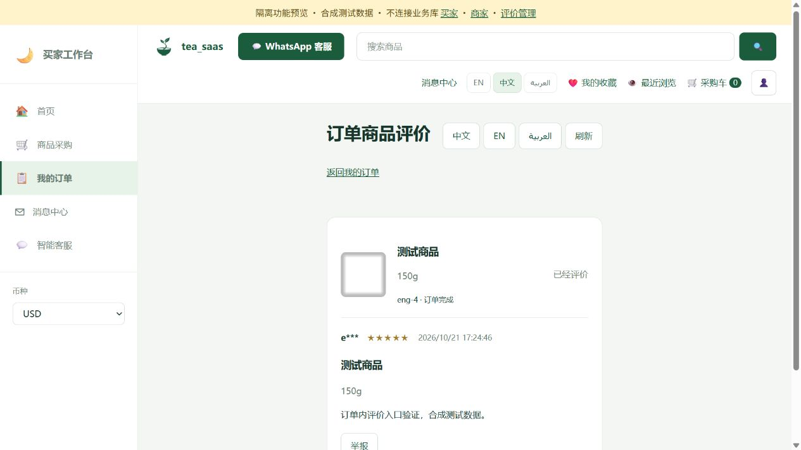

# 订单内评价入口验证 — 2026-10-21

本次为基于 c3a899b76db8150a96024241c73943715c32ce7c 的未提交增量。版本：web 0.25.1、engagement 0.1.1。未提交、推送或更新PR，未操作业务数据库或8000服务。

## 改动

取消买家侧栏独立“我的评价”；从订单商品的“评价商品／查看评价”进入绑定 order_item_id 的明细，保留订单待评价筛选。明细不提供跨订单列表或全局筛选，支持返回我的订单；无有效订单商品参数返回订单页。本人／本店评价接口增加订单商品过滤，原归属校验保留。商家与运营管理保持原入口，未增加迁移。

## 验证

- `E:/miniconda/envs/dadashop/python.exe -X utf8 .scratch/engagement-publish-20261021/run_checks.py sqlite`：102项，97通过、5项既有后端限制跳过，仅内存SQLite。新增回归覆盖同SKU不同订单、他人买家和他店商家隔离。此轮未重复MySQL验证，不涉及结构变化。
- 交付工作区运行 `E:/New Folder/node.exe --test client/tests/engagement.test.js`：4项通过。
- `node --check client/static/js/engagement-reviews.js`、`git diff --check`：通过，语法结果不代替页面验收。
- 浏览器使用8871隔离预览、合成SQLite和Redis替身；相关JS、模板和后端文件与交付工作区逐文件核对一致，未连接业务MySQL、真实Redis或AI。预览脚本及合成数据不交付。
- 页面验证：侧栏无独立评价入口；从订单商品查看，仅显示当前商品项评价；从未评价商品进入表单，提交5星与合成文字后显示已保存结果；返回订单后按钮变为“查看评价”；直接访问无参数 buyer_reviews.html 返回订单列表。未操作真实买家记录。

## 后续修正：订单咨询兜底入口

web 0.25.2移除 can_contact=false 时的总消息中心链接，订单脚本缓存参数更新为20261021-order-actions。2026-10-21在8000真实登录页面刷新并筛选待付款，7笔订单均正常展示，商品区总消息中心链接为0、评价入口为0；未支付／隐藏订单，未写业务数据。JS语法及git diff --check通过。本轮未重复全量测试，未提交或推送。截图仅保留本机忽略目录，不将真实订单截图纳入Git。
