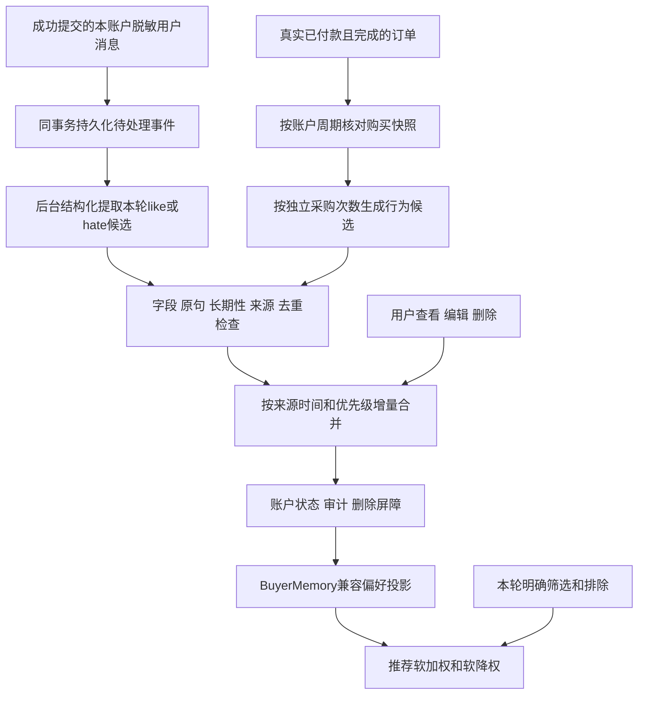

# 账户偏好自动维护

任务：PROFILE-AUTO-20261111。状态：已实现；2026-11-11用户另行要求“应用”后，本地业务库迁移已核验、自动维护已启用。仓库默认仍关闭，其他环境须独立授权及验证，见[本机启用证据](../../evidence/2026-11-11-automatic-account-preferences-activation/verification.md)。此规格替换现行文档中“长期偏好只可显式编辑、不得自动更新”的限制；历史证据保留原时点。

## 目标与边界

聊天表达或真实购买行为产生候选，程序验证来源、字段和冲突后增量更新本人账户档案，推荐只作软排序。账户是唯一归属，不增加subject或“替谁购买”的判断。一般推荐偏好允许可纠正误差，不把该容错扩展到身份、金额、库存、订单事实或是否真的购买。不逐项要求用户弹窗确认，保留查看、编辑、清空能力。

## 聊天候选

仅提交成功且无合规阻止／失败工具的SupportTurn可生成任务，事件与该轮在同一PostgreSQL事务提交；重放request_id不产生第二条事件。JSON／SSE在模型处理前由服务器记录请求准入时间，成功提交后写入本人事件；不能用慢请求提交时间覆盖更晚到达的新纠正，也不采信客户端或模型提供的时间。旧内部调用未提供准入时刻时仅兼容提交时间。队列只保存已提交来源引用，不另存未脱敏聊天。模型调用在事务外后台执行，不增加聊天关键路径的模型调用。

模型只接收该轮脱敏用户原句，不接收助手文字、订单详情或整份账户档案。候选字段为type(category／brand／keyword)、value、polarity(like／hate)、scope(long_term／current_turn)、quote；不允许subject、账户、订单、来源时间或数据库表达式。每轮最多6项；只提取新增／变化，不重新生成档案，无依据返回空。

结构合法不等于语义正确。程序要求quote逐字属于来源、value可由quote定位且不含PII、类型受限、长度合法，拒绝本次／今天等临时条件、明显极性倒置、同项冲突及重复。模型理解隐含语义，程序采用保守支持域；程序／替身测试不代表真实提取准确率，未覆盖表达可不入库。

后台每次提取最多1次模型调用、768输出Token、15秒提供商超时、无SDK自动重试；较原有192 Token口径阶段使用更大上限以容纳多项逐字证据，但不改变该口径阶段。任务失败采用持久化重试而非重放聊天。最多5次尝试、指数退避，超限进入dead并保留错误码；不在日志记录问题原文或私有订单。租约使崩溃任务可回收；过期worker不能写入或标记另一worker的任务成功。

## 购买行为

只读取本账户、人民币、有可靠支付时间且已完成的标准单(status=4)、试单(status=8)、预售单(status=6且定金尾款齐付)，排除支付异常、退回或取消。使用真实paid_at／预售尾款时间，不把创建、扫描或updated_time冒充付款时间；缺少可靠时间的历史记录不推断，报告跳过计数。尚无完整通用退款模型，按现存可核验状态撤销贡献，未来退款事件需接同一快照规则。

统计窗口180天。checkout_request将同次跨店子单合成一次独立采购；缺少可靠结算组的旧单按本人同一付款日期合并。单次同项重复SKU和大批量件数只影响金额，不增加采购次数。

- 至少3个独立采购、跨度至少14天：可形成较强行为信号。
- 至少2个独立采购、间隔至少1天且不超过30天：可形成中弱复购信号。
- 单次商品金额达到人民币1000元：只增加弱信号，不直接判为强长期喜好；单次普通购买也是弱证据。
- 行为只产生like，不从未购买、点击、推荐未采纳或沉默推断hate。

默认原始权重：三次跨14天为3.0，每增加一次加0.2、最多4.0；两次满足短间隔为1.25；其他两次独立采购为0.7；单次大额0.35、单次普通0.15。再按90天半衰期计算投影权重；这些是本轮默认实现参数，不冒称已完成人工确认的生产调优。

行为权重随最近真实支付时间按90天半衰期衰减；低于0.5的弱信号仅保留审计，不进入同权重偏好列表。当前SKU／SPU分类和品牌只能说明当前关联，不能伪造缺失的历史购买分类快照。

使用可分页的全账户循环核对，不单独依赖post_save或updated_time，以覆盖QuerySet.update与退单。账户集合包含旧档案／旧行为任务，全部退单后仍能处理空快照。每个账户锁内读取并入队，快照fingerprint未变不重复入队；变化递增generation，退款后恢复相同fingerprint可产生新一代。旧代结果不能覆盖新代，应用前复核当前快照。空快照移除旧行为贡献，不清除显式表达。

## 合并、显式删改与兼容

运行仍使用统一PostgreSQL default连接。新增账户状态、更新任务、审计表与现有BuyerMemory分工：状态维护归一化条目及删除屏障，任务维护可靠交付，BuyerMemory.preferences保存原接口可读投影。行锁按账户串行化首次创建、人工修改、候选合并及投影写入，应用结果与完成任务同事务提交。

人工编辑和聊天明确表达优先级相同，按真实来源时间更新；都高于行为推断。明确纠正可以更新先前like或hate，迟到的旧提取不覆盖后来的纠正。同一时间采用确定性顺序，反复投递不增加权重。候选的owner、source_ref、source_at来自程序复读的真实来源，不采纳模型提供的身份或时间。

人工PUT只处理提交字段；旧客户端的categories／brands／keywords不清空新增的disliked_categories／disliked_brands／disliked_keywords。每个提交字段留下时间屏障，阻止该字段尚未处理的旧候选新增未知条目；删除一个已知条目还留下neutral屏障，行为不能立即恢复。清空账户档案保留reset_at及tombstone，旧候选不因BuyerMemory为空而重新写回。新的明确聊天纠正可在此后更新，行为仍不得覆盖明确条目。人工屏障在自动开关关闭后仍持续维护，因此部署新代码前也必须先应用新迁移。

旧BuyerMemory三字段档案在首次维护时按原更新时间作为显式偏好延续，不重写成行为推断。每一类like／hate投影最多5项，规范化去重；条目键复用既有受控茶类别名（如oolong tea／乌龙茶），不擅自翻译其他值，也不改变原value和逐字quote证据。行为重算只替换行为记录，显式记录不随行为衰减消失。

## 推荐、权限和启用

推荐通过现有本人MCP偏好读取取得六字段投影。喜欢项加权，不喜欢项降权；hate不进入硬excluded，like不进入required。本轮明确required/excluded优先，普通推荐、分茶类推荐和总价组合使用同一软排序，偏好服务故障仍沿用当前必要／可选依赖边界。

分类和品牌沿用受控名称匹配，keyword沿用SKU／SPU名称匹配；不把名称未覆盖的口感词臆认为已经由商品属性证实。软偏好只是候选排序信号，不保证每项偏好都有可核验的商品匹配。

人工REST接口保留本人鉴权，新增正负字段均可查看编辑清除。模型及公共商品DTO不返回账户审计或私有订单引用。事件删除／来源已不存在、归属不符、错误结构和租约过期均拒绝，不凭缓存恢复来源。

`GET /v1/support/preferences/`返回兼容的preferences，含categories／brands／keywords和disliked_categories／disliked_brands／disliked_keywords六个列表，各最多5项、每项1—40字。`PUT`为提交字段增量替换，缺省字段保持；同项正负冲突或非法值返回400，内部条目容量保护返回409 PROFILE_CAPACITY；请求体最多8192字节。`DELETE`清空投影但保留上述屏障。内部最多500个归一化条目（含neutral）；达到后拒绝新增而不静默丢弃旧显式记录，需运维检查与审阅压缩，当前不提供自动丢弃tombstone的清场机制。

行为快照最多检查1000个完成订单及10000个商品项，超界返回snapshot_limit并报告有限错误码，不应用部分统计；旧行为仍按90天半衰期降权。这不是完整外部退款感知，也不是大账户全量统计已完成的证明。

默认SUPPORT_AUTO_PROFILE_ENABLED=false。本机已按单独授权完成备份实恢复、仅新增三表的迁移核验、开启本地配置、统一入口启动偏好worker及两个有界真实抽取样例；实际接口／MCP和版本证据单列，不代表其他环境启用或通用语义质量已验收。其他环境仍依次完成上述前置验证，统一预览入口按开关管理唯一偏好worker，见[交付证据](../../evidence/2026-11-11-automatic-account-preferences/verification.md)。停用自动功能不删除账户或人工删除屏障。本功能只维护账户偏好，不承担咨询中采购任务的保存或切换，不要求引入独立任务模型；不新增独立NLI分类器。

## 验收

覆盖长期／临时、like／hate纠正、quote不符、PII、无来源、重复及乱序任务、跨咨询慢请求、租约过期、并发首次写和人工修改；跨店拆单／批量不增加复购、短间隔规则、单次大额弱信号、退款取消与空快照、历史缺时间；旧三字段兼容、显式删改屏障、正负偏好软排序和本轮硬条件优先；提交回滚／重放、默认关闭不启动自动处理、来源不会外泄给模型。提取守卫拒绝只保存index与有限原因码，不保存被拒原文；运维修复后可显式`profile_worker --retry-dead <UUID>`重排单条死信，保留原来源及重排计数，不自动无限重建任务。
