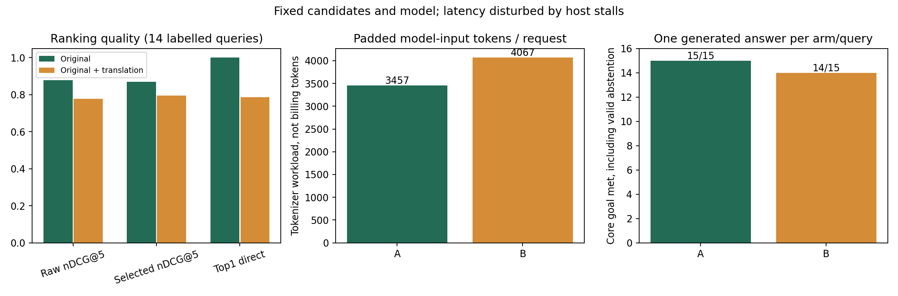

# 重排序查询输入的真实模型A/B实验

日期：2026-10-26（Asia/Shanghai）。A＝原问题＋候选；B＝原问题与审核后的直接翻译拼接＋同一候选。

## 结论

在这套15题、英文公开知识快照的回归样本中，**原问题输入更适合作为下一步验证的默认方案**：A的原始nDCG@5为0.8780，B为0.7777；B的前五直接相关片段占比略高，但首位命中更差，且后续证据选择丢失一题关键证据。B实际padding后的模型输入工作量增加17.6%。这不是所有知识库、语言或完整Agent链路的普遍结论，尚未修改线上策略。

## 控制变量与执行范围

- 15题覆盖中文、英文、混合语种和阿拉伯文，问题来自已有回归集；其中11题完整可回答、3题部分资料缺失、1题虚构配方无资料。50片段均为2026-10-16公开快照，全部为英文，未读取客户问答、订单或私有知识。
- 每题固定原问题单路历史召回的30个有序候选；两臂及三次重复完全相同，不重新召回、不插入金标片段。本实验不运行RRF、向量模型或补检，隔离重排输入的影响。
- B使用一次真实DeepSeek直译并在结果出现前审核冻结；英文原问译成中文，其余译成英文，不做同义扩展。第9题初次多了拼音释义，另一次付费直译移除；两次原始用量都保留。
- 本地模型BAAI/bge-reranker-v2-m3，revision953dc6f6f85a1b2dbfca4c34a2796e7dde08d41e；CPU、4线程、batch4，96查询token／512pairtoken，模型与tokenizer一致。
- 每组45次正式请求，合计90；另2次预热不进质量/配对均值但进入实验成本记录。固定随机题序，AB/BA随题号和轮次交替；30秒服务预算，实验关闭回退和补检。未改变线上配置。
- 相关性0/1/2标注在查看重排输出前冻结，覆盖50片段全部组合：2直接支持核心事实，1有用背景，0无关。保留历史support_groups另算覆盖。由Codex对照语料标注，没有独立专家复核；重复不当作独立质量样本。
- 每题取最早两臂都成功的一轮，分别真实生成一次答案，合计30次。相同原问、提示、temperature0、thinking disabled、max_tokens1000；线上当前thinking enabled未改动。这里只是固定证据后的次级生成实验，不是完整Agent端到端测试。

## 质量指标

排序均值按14道有正例题目等权；无正例的虚构配方题不计算nDCG/MRR。只用成功配对计算质量；每个题目均有至少一组成功配对。候选内理想顺序为nDCG分母，P/Recall直接相关定义为grade2；Recall分母为冻结50片段中的全部直接相关片段，并非本次新召回的检索召回率。

| 指标 | A 原问题 | B 原问题＋直译 |
|---|---:|---:|
| 原始重排nDCG@5（越高越好） | 0.8780 | 0.7777 |
| 原始P@5（直接相关） | 38.6% | 42.9% |
| 原始Recall@5（直接相关） | 82.9% | 87.9% |
| 原始MRR | 1.0000 | 0.8571 |
| 原始首位直接相关命中 | 14/14 | 11/14 |
| 原始前五核心支持点覆盖 | 100.0% | 100.0% |
| 证据选择后nDCG@5 | 0.8704 | 0.7955 |
| 证据选择后核心支持点覆盖 | 100.0% | 92.9% |
| 答案核心目标达成（含正确指出缺口） | 15/15 | 14/15 |
| 11道完整可答题的核心完成 | 11/11 | 10/11 |
| 有明确附加事实错误的答案 | 0/15 | 3/15 |
| 严格证据忠实（含共同语义收窄风险） | 14/15 | 11/15 |
| 整答严格通过：核心＋忠实＋引用 | 14/15 | 10/15 |
| 引用ID均来自输入证据 | 15/15 | 15/15 |

不能将核心目标达成称为整答事实准确率。B有4题原始nDCG改善、4题持平、6题退化。题目bootstrap中B−A的平均nDCG差为−0.1004，95%区间[-0.2238, 0.0126]，跨0；样本小且含同题多语言版本，不宣称总体统计显著。按题族重采样的探索性结果见summary.json，不替代独立题集。

## 关键案例

- **第14题，80℃是否必须固定**：候选74在两臂相同池中。A将74排第1并保留；B排为65、68、74，三者同属ISO文档，来源优先规则只保留前2段，74被挤掉。A正确说明不必统一80℃；B忠实拒答但没有完成本来有资料的目标。问题出在重排与证据选择的交互，不是召回遗漏。
- 第1/2/3题中B引入更多红茶工序相关片段，局部P@5或nDCG有所提升；并非双语输入全部退化。
- 第5、12题中B把消费预测或其他国家文化排到目标习俗前面；程序覆盖规则又将59前移，说明原始重排和最终证据应分别评估。
- **生成错误单列**：B第5题把US$221.010million写成22.101亿美元，正确为2.2101亿美元；B第7/13题把black tea误译为黑茶。每臂只生成一次，不能断言这些生成错误是拼接必然造成。
- A/B第12题均把片段59的“有午晚餐场合可能稍后供应茶”收窄为“餐后奉茶”，记为共同证据风险，不冒充已被外部事实证伪。阿拉伯题两臂均用阿拉伯语回答，偏离中文格式提示，但事实目标成立。
- 虚构配方题两臂都未编造配方。没有真实正例时，模型照样给候选打分；分数不等于事实正确概率。

## 成本与运行异常

**先说明有效性边界**：90次中A成功36/45、B成功35/45，共71次成功、19次失败；34组完整成功配对，7次CPU采样缺失。第70次后资源采样异常令进程中断；健康与空闲恢复后只继续20个未尝试请求。后段出现读超时、忙碌及墙钟长时间停顿，最长约798.7秒，远超40秒客户端预算。故不能把所有请求的A平均19.86秒、B平均45.16秒归因于查询形式，也不据此发布P95或SLA优劣结论。原始异常未删除或重跑，详见run-interruption.json和逐请求记录。

| 成本指标 | A | B | 解释 |
|---|---:|---:|---|
| 每题查询token均值 | 16.20 | 36.53 | 实际同版本tokenizer；均未超过96 |
| 每请求pair token（未padding） | 2987.3 | 3597.3 | 查询会与30个候选分别配对 |
| 每请求pair token（含padding） | 3457.1 | 4067.1 | B增加17.6%，计算工作量代理，不是FLOPs或账单token |
| 每请求窗口／batch数 | 30／8 | 30／8 | 无新增窗口、无查询截断 |
| 成功配对墙钟均值，仅描述 | 18.08秒 | 20.93秒 | 约+15.8%；有环境噪声和成功样本选择偏差 |
| 成功配对CPU均值，仅描述 | 72.24核秒 | 83.55核秒 | 约+15.7%；采样含少量监控开销 |
| 服务RSS峰值采样 | 2156.2MiB | 2156.2MiB | 同一常驻模型，非独立内存峰值实验 |
| cgroup内存峰值采样 | 3147.7MiB | 3147.6MiB | 包含文件缓存；不是纯模型RSS |
| 生成答案API输入／输出token | 8304／2587 | 7943／2539 | 15次/臂，输出长度/证据不同，缓存亦影响费用 |

环境异常不影响由冻结文本重新计算的token工作量，但限制延迟、CPU单臂归因和服务成功率外推。不能将本次重排失败率等同线上客服HTTP失败率，线上仍有回退策略。

### API金额

按[DeepSeek官方费率](https://api-docs.deepseek.com/quick_start/pricing/)（2026-10-26读取）及API返回的缓存命中/未命中和输出token估算，列出谷/峰费率范围，不声称已核对账户账单。

- 本次真实API共46次：15次初译＋1次修订＋30次答案。输入18707、输出5476 token，其中输入缓存命中1792。合计估算 **US$0.005828–0.011656**。
- A的15次答案估算US$0.002685–0.005370；B的15次答案US$0.002564–0.005129，单次生成波动与缓存使其略低，不能据此认定B完整链路更便宜。
- 如果为B单独新增翻译，15条最终采用的直译增加约US$0.000537–0.001073及平均1.095秒；若翻译已在多路召回中产生，则两种重排方案共享这笔成本，B不应重复计费。实验实际花费仍包含被舍弃的初译。
- 本地重排没有外部按token计费，但CPU、内存驻留、硬件折旧与电费不为零；本次没有功率计或机器计价，**无法给出完整人民币总成本**。CPU是容器采样，发生未完成推理后也可能包含上一个请求残留工作，不能冒充精确账单。
- 未运行embedding、召回、完整Agent编排与补检，亦未计这些成本。原问题和拼接的分数标尺可能不同；线上weak_score等策略会改变补检成本，不能由本实验推出整链成本结论。

## 建议

本题集优先保留原问题重排，再用独立题集验证；不直接根据本报告自动改线上。若要保留双语方式，应同时验证来源多样性是否挤掉唯一证据，并标定弱相关/补检阈值。性能复测需要稳定、隔离负载的主机；本次异常样本保留作诊断，不用清洗后的数字冒充原始实验。

## 复核资料

- [逐题指标CSV](per-case.csv)、[完整指标JSON](summary.json)、[原题与标签](cases.json)、[原始公开语料](corpus.json)。
- [冻结直译](translations-frozen.json)、[翻译审核](translation-review.json)、[实验配置和协议](manifest.json)。
- [90次原始重排](rerank-results.jsonl)、[两次预热](warmups.jsonl)、[tokenizer工作量](tokenizer-work.json)。
- [真实答案与审核](answers.md)、[答案原始JSONL](answers.jsonl)、[预先审核规则](answer-rubric.json)、[逐条判定](answer-review.json)。
- [API真实用量](api-calls.jsonl)、[中断记录](run-interruption.json)、[完整性校验](integrity.json)、[评测脚本归档](procedures.zip)。脚本仅位于本地评测目录，本次没有修改生产检索实现、迁移数据库、提交或推送。

