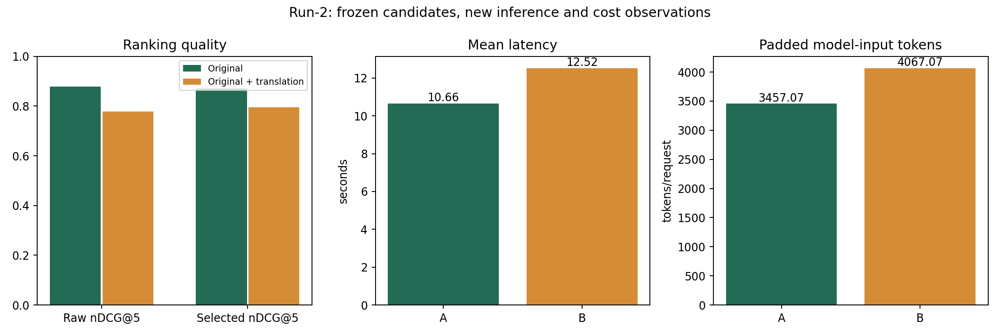

# 重排序真实模型对比：重新运行 run-2

日期：2026-10-26（Asia/Shanghai）。A＝原问题＋候选；B＝原问题与直接翻译拼接＋同一候选。

## 本轮结论

在这套公开英文知识快照回归题上，A的原始nDCG@5为0.8780，B为0.7777。B的P@5略高，但首位相关命中和最终关键证据覆盖更低。B的实际padded输入工作量增加17.6%，本机平均墙钟增加17.5%、CPU增加17.5%。优先选择原问题重排作为后续验证默认项；不据此宣称普遍或总体统计显著优势，也未自动改线上。

## 与上一轮隔离及控制变量

- run-1完整保留；本轮只复用冻结的15道题、50个公开英文知识片段、每题相同的30个候选、直接翻译和事先相关性标注。没有借用旧排名、耗时、答案、API用量或成本数据。
- 所有输入在本轮输出前冻结。原中文/混合/阿文问句的直译为英文，英文原问直译为中文；直译仅作为固定输入，本轮没有再次支付翻译调用费。
- 模型BAAI/bge-reranker-v2-m3，revision953dc6f6f85a1b2dbfca4c34a2796e7dde08d41e；CPU4线程、batch4、30秒预算、top5、来源优先2片段、正文12000字符、阈值空、回退和补检关闭。
- 15题×两臂×三轮＝90次新重排，另2次新预热；固定随机题序、AB/BA交替。不重新调用向量检索/RRF，避免候选变化混入重排对比。
- 常驻轻量Docker探针在请求前后采样CPU/内存，避免每次重新fork。测试进程临时防自动休眠；1秒心跳发现超过3秒间断即停；读超时、429或采样中断也停止，已尝试请求不自动补跑。
- 本轮检测：心跳异常0次，计时无效标记0次，资源探针失败False；结束后已解除临时防休眠。
- 11题完整可回答，3题部分缺失，1题虚构配方无资料；相关性0/1/2标注对应无关/有用背景/直接支持核心事实。由Codex对照冻结语料标注与审核，未经独立专家复核。
- 每题每臂重新真实生成一次答案，共30次；相同原问、提示、temperature0、thinking disabled、max_tokens1000；不同于线上thinking设置，但两臂相同。该次级生成不是完整Agent端到端测试。

## 质量结果

排序均值按14道有正例题目等权，重复不当成独立质量样本。虚构配方题无正例，不计算nDCG/MRR，但参与拒答审核。nDCG以同候选池理想顺序归一化；Recall分母为冻结50片段中的全部直接相关片段，不是本次新召回率。

| 指标 | A 原问题 | B 原问题＋直译 |
|---|---:|---:|
| 原始nDCG@5 | 0.8780 | 0.7777 |
| 原始P@5（grade2） | 38.6% | 42.9% |
| 原始Recall@5（grade2） | 82.9% | 87.9% |
| 原始MRR | 1.0000 | 0.8571 |
| 首位直接相关命中 | 100.0% | 78.6% |
| 证据选择后nDCG@5 | 0.8704 | 0.7955 |
| 证据选择后核心支持覆盖 | 100.0% | 92.9% |
| 新答案核心目标达成（含正确指出缺口） | 15/15 | 14/15 |
| 新答案严格证据忠实 | 12/15 | 12/15 |
| 新答案明确附加事实错误数 | 2/15 | 2/15 |
| 新答案整答严格通过 | 12/15 | 11/15 |

核心目标达成不等于整答事实准确率。答案每臂每题只有一次，生成差异不应全归因于重排。原始nDCG的B−A题目bootstrap95%区间为[-0.2238, 0.0126]，跨零；题集含同题多语言版本，不能当成独立大样本统计显著证明。

本轮逐条问题记录：

- A第6题：核心资料缺口判断正确；附加数据将FAO对2013年的历史估计一并称为预测，混淆estimated2013与projected2023的数据性质。
- B第6题：核心缺口或拒答正确；附加背景将片段53或51的black tea译为黑茶，应为红茶。第6题还把2013历史估计与2023预测合称预测。
- A第7题：核心习俗和缺口正确；附加背景将片段53的black tea译为黑茶，应为红茶。
- A第12题：共同证据收窄风险：片段59只说有午晚餐场合可能稍后供应茶，答案写成餐后奉茶；不据此声称外部事实已证伪。
- B第12题：共同证据收窄风险：片段59只说有午晚餐场合可能稍后供应茶，答案写成餐后奉茶；不据此声称外部事实已证伪。
- B第13题：拒答核心正确；附加背景把片段53/51的black tea误译为黑茶，应为红茶。
- B第14题：忠实说明当前输入证据不足，但未完成原本可回答的目标；候选74被排到第3并在来源优先规则中挤掉。

## 成本结果

| 指标 | A | B |
|---|---:|---:|
| 正式请求成功 | 45/45 | 45/45 |
| 墙钟均值 | 10.663秒 | 12.524秒 |
| 墙钟中位数 | 10.525秒 | 12.408秒 |
| 墙钟P95（45次描述样本） | 11.597秒 | 13.863秒 |
| CPU均值 | 42.667核秒 | 50.113核秒 |
| 查询token均值 | 16.20 | 36.53 |
| pair token未padding | 2987.3 | 3597.3 |
| pair token含padding | 3457.1 | 4067.1 |
| 服务RSS峰值采样 | 2156.4MiB | 2156.4MiB |
| cgroup内存峰值采样 | 3301.7MiB | 3302.2MiB |
| CPU核时/每千次（本机观察外推） | 11.85 | 13.92 |

两组均30窗口、8批，未触发96 token查询截断。每个查询与30候选分别计算，补充文本的开销被重复到各pair；token工作量是计算代理，不是FLOPs或外部计费token。模型常驻且共享，内存是采样观察，不是两台独立机器的峰值比较。墙钟/CPU结果只代表本机当时条件，不推广为生产SLA。

核秒是所有CPU线程耗时之和；本服务使用4线程，因此约10.7秒墙钟对应约42.7核秒，不表示用户等待42.7秒。本轮与旧轮的环境处理不同，不将跨轮耗时差异称为业务实现提速。

### API费用

本轮实际API调用30次，输入16247、输出5221 token，缓存命中11259。按[DeepSeek官方费率](https://api-docs.deepseek.com/quick_start/pricing/)及返回用量，估算本轮费用US$0.003915–0.007829（谷/峰费率范围，非账户账单）。本轮冻结直译没有新增调用费；若实际系统已在上游生成翻译，不应重复计费，若为重排另加翻译则需另计。

本地重排没有外部按token费用，但CPU、内存、电费及硬件不为零。本次没有机器单价或功率计，无法把本地计算准确换算为人民币。未计embedding、召回、完整Agent编排和补检成本；绝对重排分数会影响线上weak_score补检，不由本实验推出整链节省。

## 关键例与审核

第14题关键片段74两组都在相同候选池。A排第1并保留；B排第3，前面65/68与74同属ISO文档，来源优先规则挤掉74。分别查看本轮[真实答案与逐题审核](answers.md)，不能用旧轮答案替代本轮生成。其余逐题指标和生成错误均保存在下列文件中。

## 限制与复核文件

这是15题、公开英文知识快照的小型回归实验，非独立留出集；不代表当前整个知识库的跨语言能力。没有修改线上策略、数据库或Git交付。原问重排的低绝对分数与弱相关/补检阈值还需完整链路验证。

- [实验协议](manifest.json)、[冻结标签与候选](cases.json)、[冻结直译](translations-frozen.json)、[公开原文](corpus.json)。
- [90次新重排](rerank-results.jsonl)、[新预热](warmups.jsonl)、[新tokenizer统计](tokenizer-work.json)、[全部指标](summary.json)、[逐题CSV](per-case.csv)。
- [新生成答案](answers.jsonl)、[逐题审核](answer-review.json)、[新API真实用量](api-calls.jsonl)。
- [环境预检](preflight.json)、[运行结束状态](run-state.json)、[逐请求环境有效性](environment-validity.jsonl)、[完整性校验](integrity.json)、[脚本归档](procedures.zip)。

